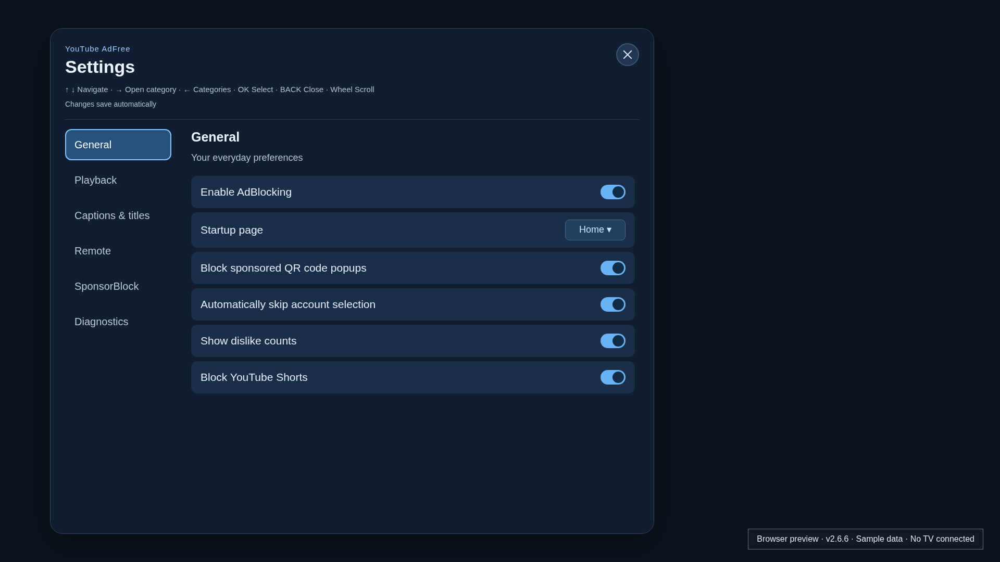
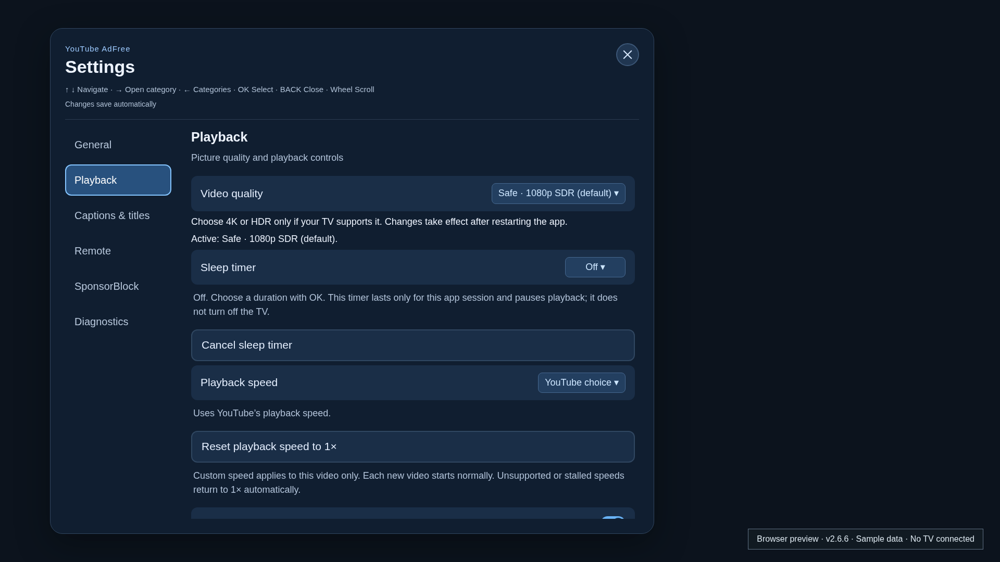
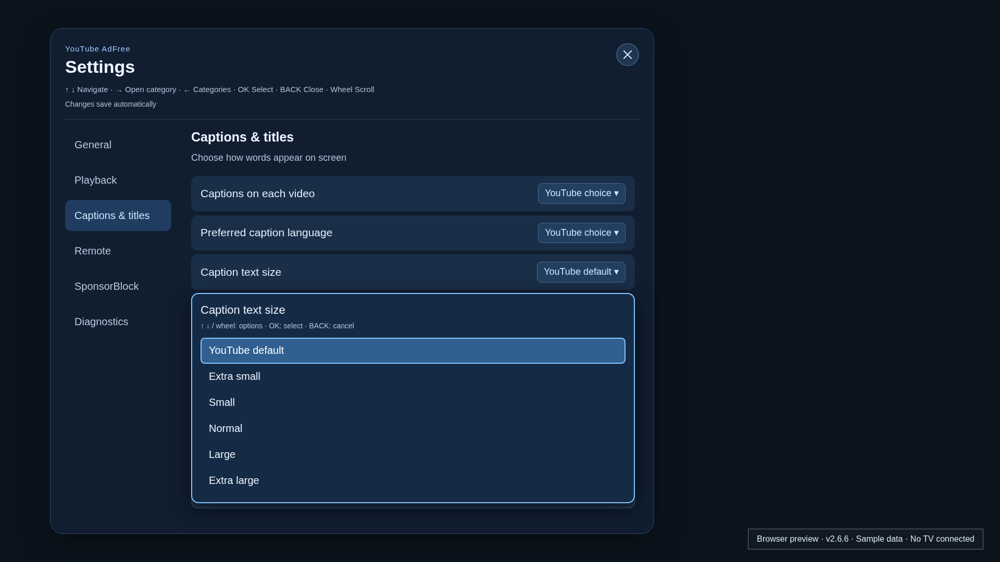
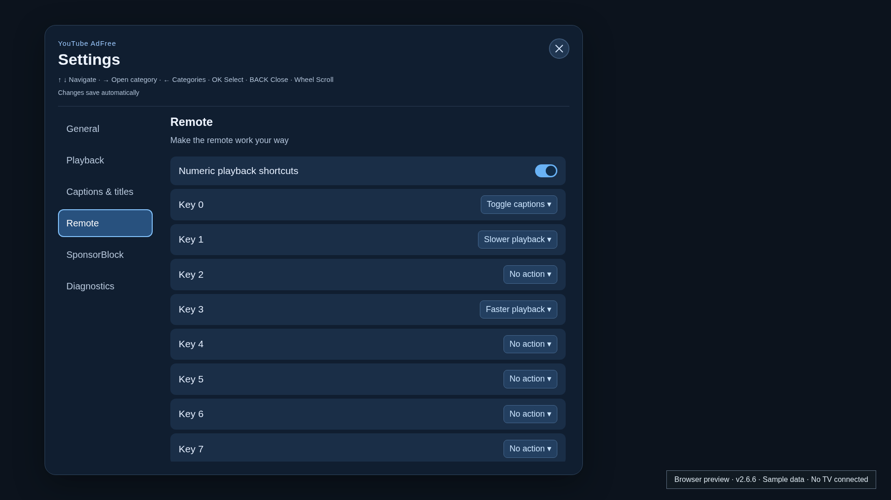
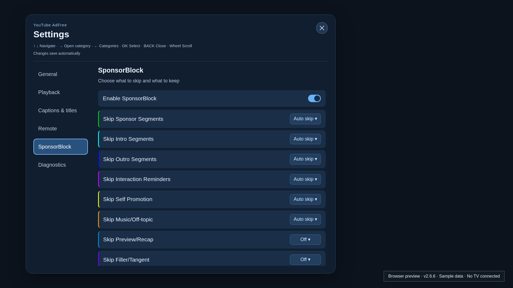
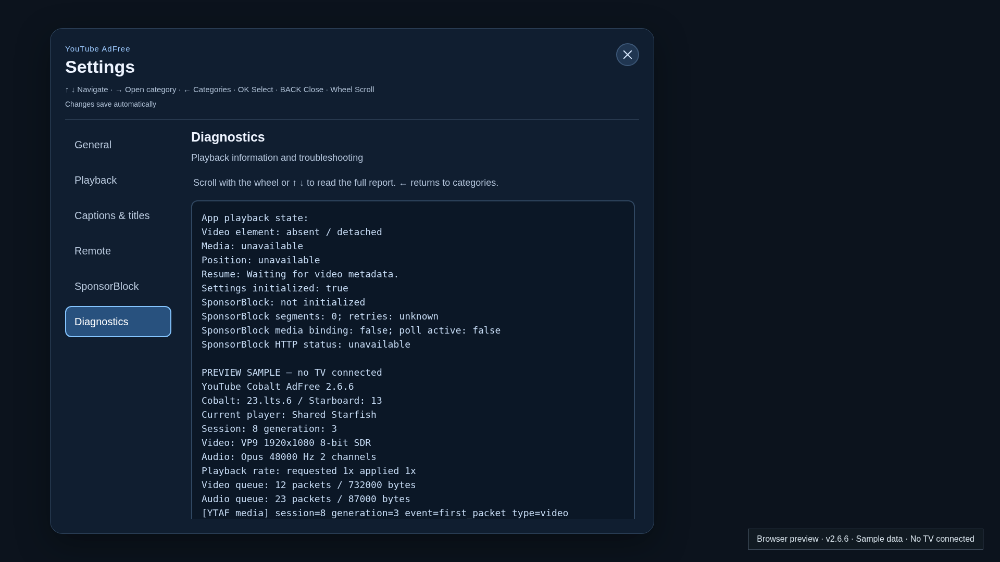

# YouTube webOS Cobalt AdFree

A YouTube TV app for LG webOS with ad blocking, SponsorBlock and extra playback controls. No root required for normal use.

Based on **[RF1705/youtube-webos-cobalt-adfree](https://github.com/RF1705/youtube-webos-cobalt-adfree)**. Credit to the original project and contributors for the starterless Cobalt/webOS runtime, ad blocking, SponsorBlock and YouTube TV integration. The in-place Home-refresh command is adapted from [NicholasBly/youtube-webos](https://github.com/NicholasBly/youtube-webos).

## Download and install

**[Latest release: v2.6.47-beta.1](https://github.com/danzig666/youtube-webos-cobalt-adfree/releases/tag/v2.6.47-beta.1)**

| Package | Download | Behavior |
| --- | --- | --- |
| Original ID · `youtube.leanback.v4` | [IPK](https://github.com/danzig666/youtube-webos-cobalt-adfree/releases/download/v2.6.47-beta.1/youtube.leanback.v4_2.6.47_arm.ipk) | **Replaces official YouTube; recommended for voice search on the tested C3** |
| Separate ID · `com.cobalt.youtube.adfree` | [IPK](https://github.com/danzig666/youtube-webos-cobalt-adfree/releases/download/v2.6.47-beta.1/com.cobalt.youtube.adfree_2.6.47_arm.ipk) | Installs alongside official YouTube; microphone capture was rejected on the tested C3 |

**2.6.47** adds continuous pointer scrolling: keep the pointer near either row edge to pan, and move inward to stop between tiles. It avoids refocusing passing tiles, reuses row geometry, and shows a short frame-timing status under **GREEN → General → Pointer row scrolling**. For Hungarian voice search, use **YouTube Settings → Language → Magyar**; the TV may stay English. The Homebrew catalog offers 2.6.47.

Bundled AAC fallback remains included for C4/webOS 26 livestream compatibility, alongside the startup improvements. The older firmware-only 2.6.36 experiment is not recommended for C4 livestreams.

Install using webOS Device Manager or `ares-cli` with Developer Mode, or Homebrew Channel on a compatible setup. Update the same package ID you already use, then fully close and reopen the app. Checksums and build records accompany each release.

**Homebrew Channel:** under **Settings → Add repository**, enter:

```text
https://raw.githubusercontent.com/danzig666/youtube-webos-cobalt-adfree/main/repo.json
```

The catalog lists both variants and updates automatically from verified published releases. Choose **Separate ID** to keep official YouTube, or update the ID you already use. [Catalog details](docs/homebrew-catalog.md).

Both variants share the playback features and have separate storage. YouTube sign-in remains available; **separate-ID sign-in/phone pairing are not TV-verified**. Use this fork’s separate-ID IPK to keep official YouTube.

## Features added in this fork

The original ad blocking, Return YouTube Dislike, automatic account selection, startup-page choice, Shorts toggle and sponsored QR blocking remain available.

| Addition | What it does |
| --- | --- |
| Blue settings interface | Inter typography, TV-safe margins, instant category switching on focus/hover, visible focus and direct option lists |
| Home refresh | YouTube’s in-place soft-refresh command, available in General and on number keys; confirmed working on the LG C3 |
| Magic Remote support | Cursor selection and wheel scrolling in settings, option lists, help and diagnostics |
| Pointer row scrolling | PlxNative-style hover focus and smooth reveal of clipped cards in horizontal browsing rows; on by default, with an off switch in General |
| In-app voice search | Magic Remote microphone capture with language controlled by YouTube. Hungarian voice search confirmed on C3 with the original-ID package; microphone status and bounded cleanup. |
| Bundled software AAC | Private ARMv7 audio decoder for the existing legacy playback path; avoids relying on firmware AAC libraries |
| Video quality profiles | Safe 1080p SDR, 4K SDR or 4K HDR; saved on the TV and applied after a full restart |
| SponsorBlock category actions | Auto skip, Ask first, Markers only or Off for each category |
| Permanent channel exceptions | Disable all SponsorBlock skipping for a channel; manage and remove saved exceptions |
| Playback resume | YouTube watch history, resume during loading from confirmed session progress, and optional persistent TV fallback |
| Quick seeking | Channel + forward / Channel − backward in 10-second steps applied 0.5, 0.8 or 1 second after release; repeated taps combine into one seek, with a target marker and timestamp |
| Higher-quality Auto startup | Optional highest available quality at startup, then Auto adapts normally; manual choices stay unchanged |
| Playback speed and reset | 0.5×–2× for the current video, progress monitoring, failure recovery to 1× and a dedicated reset action |
| Corner clock | Optional plain white clock in menus and with the seekbar; shifts slightly every three minutes and hides during clean playback |
| Thumbnail progress | Updates the watched video’s red thumbnail bar on return without refreshing or rearranging the feed |
| Sleep timer | Pause after 15, 30, 60 or 90 minutes, with countdown and cancellation |
| Stop after this video | Hold subsequent autoplay paused until Continue playback |
| Configurable remote keys | Separate action selectors for keys 0–9, optional shortcuts and built-in remote help |
| Caption preferences | Startup on/off behavior, preferred language, six text-size choices including YouTube default, and a thin black outline around custom-size letters |
| Optional DeArrow | Community titles or titles and thumbnails; off by default, with a temporary Show originals action |
| Startup timings | Native initialization and YouTube page/screen milestones in Diagnostics |
| System fonts | Prefers LG’s installed fonts; retains bundled fallback fonts and Inter settings typography |
| Scrollable diagnostics | App/runtime versions, capability policy, codecs, rates, queues, resume/SponsorBlock state, script/update delivery, Home-refresh reasons and bounded playback events |
| TV capability test | Read-only LG panel/UHD/OLED/HDR flags and optional Starfish decoder limits; configured Cobalt support is shown separately |
| Optional display controls | Hide end screens, recommendation sign-in prompts or the YouTube logo; prefer sharper standard thumbnails; all off by default |
| Durable preferences | Private per-install saves, migration from older browser settings and visible save-failure feedback |
| Homebrew updates | Maintained catalog for both IDs, generated from verified release packages with exact sizes and checksums |
| Two installable variants | Original-ID and separate-ID IPKs with matching runtime identities, build records and SHA-256 checksums |

Press **GREEN** to open settings. Use arrows and **OK**, the cursor or the wheel; **BACK** cancels an option list first, then closes settings without closing the video. Default numeric shortcuts: **0** captions, **1** slower, **3** faster. Assign **Reset playback speed to 1×** or **Refresh Home recommendations** under Remote. Home refresh works only on Home. Refresh sends YouTube’s `SOFT_RELOAD_PAGE` command, using the method from NicholasBly’s app; it does not require opening the sidebar. Older runtimes without the event API can use a sidebar round trip. YouTube decides which recommendations are returned.

**Playback → Higher-quality Auto startup** briefly requests the highest level exposed by YouTube, then returns to Auto. It defaults off, respects manual quality choices and does not expand the TV’s codec/HDR capabilities. **Left/Right always use YouTube’s normal seeking. Channel + / − use quick seeking**, with the visible target and 0.5-second delay after release by default. Choose 0.8 seconds, 1 second or Off under **Playback → Channel + / − quick seek**. Existing automatic-seek delays are preserved. Channel seeking stays inactive in menus and recommendation lists. The startup-quality idea comes from [LawfulGremlin’s v2 branch](https://github.com/LawfulGremlin/youtube-webos-cobalt/tree/v2); see [behavior and validation](docs/auto-quality-and-channel-seeking.md).

**Hungarian voice search:** in **YouTube’s own Settings → Language**, choose **Magyar**, then use the microphone inside YouTube Search. The TV may stay in English. This works on the tested C3 with the original-ID package. The physical remote microphone button can still launch LG’s system assistant. [Details](docs/hungarian-voice-search.md).

**Ad blocking defaults on.** Home, continuation and Shorts ads are filtered before YouTube renders the response, including nested ad tiles and mastheads. Sponsored QR blocking has its own switch. Adapted from [upstream #119](https://github.com/RF1705/youtube-webos-cobalt-adfree/pull/119), with our Cobalt DOM fallback retained. [Details](docs/early-ad-filtering.md).

**General → Pointer row scrolling** follows [PlxNative](https://github.com/danzig666/plx-native): point at a clipped card near either end of a horizontal row to reveal it. Arrow keys take over until you deliberately move the pointer again. It defaults on and excludes playback and menus. [Behavior and validation](docs/pointer-row-scrolling.md).

Four optional display controls are under **General** and default off. Logo visibility changes immediately; feed/video filters apply when the next response loads. Use Home refresh when desired. Sharper thumbnails depend on YouTube’s available image variants. These options do not automatically refresh the Home feed or disable normal sign-in.

Use **Diagnostics → Run capability test** to inspect the TV’s reported panel/HDR flags and decoder limits in the existing scrolling log. The test uses ordinary LS2 client queries and explains denied/empty replies. Identical decoder ceilings are not proof of panel resolution or HDR. Missing fields stay unknown; the test changes no settings. See [test details](docs/tv-capability-test.md).

Choose a quality profile your TV supports; restart to apply it. Custom speeds require shared A/V and reset each video. Resume gives YouTube watch history priority: sign in and keep history enabled for account synchronization. Within the current app session, reopening a video also uses the confirmed position behind its red thumbnail bar if YouTube supplies none. This transient cache does not survive an app restart. Optional TV fallback gives YouTube priority and keeps up to 100 unfinished VODs for 90 days, excluding live/DVR and Shorts. Clearing TV bookmarks does not clear account history. Timers pause playback, not the TV.

YouTube default restores native caption styling. DeArrow sends visible video IDs to public services when enabled. Backup/restore and the separate comments reader are excluded; use YouTube’s comments.

## Fixes and playback hardening

- **Livestream AAC startup:** the C3 log identified AAC decoder creation failing after media packets arrive. The app now bundles its software AAC decoder instead of relying on firmware libraries, while retaining the existing playback backends and fallback paths. Real AAC decoding and loader/packaging regressions pass; **the C3 tester confirmed livestream playback works in 2.6.31**. See [the evidence and fix](docs/live-playback-investigation.md#c3-diagnostic-capture--aac-decoder-unavailable).

- **Community adaptations:** fixed ad hiding on Cobalt DOM collections without `closest()`/NodeList `forEach()`, normalized valid decimal-bitrate capability queries, added bounded query diagnostics and enabled conservative native compiler caching. Frame-rate/hardware policy stays unchanged; C3 speed/quality behavior needs device testing. See [fork sources and validation](docs/fork-improvements-2026-10.md).

- **Startup and fonts:** adapted upstream direct logging and system-font support, with concurrent-safe file rotation, debug-only per-script success tracing, startup timings, retained bundled fallbacks and an overlapping-family ownership fix. See [startup findings](docs/upstream-startup-improvements.md).

- **Home refresh:** fixed the silent Home-detection failure caused by Cobalt lacking `URL.searchParams`; Home detection uses its supported query-string interface. Removed the full-reload button, shortcut and code; saved full-reload assignments become No action. Added the reference `SOFT_RELOAD_PAGE` command and corrected Home detection for current `FEtopics` alongside the older `FEwhat_to_watch`.

- **Clock:** raised to 2% from the top edge to clear the YouTube logo and moved to a 2% right margin; OLED movement stays upward. Fixed visibility and recovery; removed the dark box, added a small three-minute position shift and hid it during playback when menus and the seekbar are down.
- **Thumbnail progress:** uses confirmed playback to update matching cached thumbnails on return; preserves card order, selection and scroll, with no feed refresh or account API.
- **Fonts:** moved Inter from embedded data URLs to installed font files after reproducing a security-policy rejection. Both weights load under the restricted browser test; C3 appearance still needs confirmation.
- **Settings:** corrected clipped category headings and Diagnostics Up navigation, blocked cursor clicks outside the modal, and recovered BACK/OK after missing key releases. Fixed adblock preference saving, malformed configuration recovery, BACK closing the video, the off-centre close icon, the empty blue notification pill and QR controls appearing on every category.
- **Option lists:** fixed cursor selection, open/close flicker, stale popups after category changes, duplicate key/mouse activation and clicks passing through to underlying switches. Remote keys now have individual selectors.
- **Captions:** fixed styles not activating on Cobalt, sizes being overwritten by YouTube and competing font-size updates. Added smaller sizes, stable sizing across cue replacement, measured feedback and the thin outline without a black bar.
- **Seeking and resume:** fixed Channel + / − being blocked on an already-visible seekbar or after native arrow navigation; current transport controls and redrawn timelines now remain eligible. Moved previewed quick seek to Channel + / −, with native YouTube Left/Right restored; channel seeking starts at 0.5 seconds and keeps earlier automatic delays. protected the video list below the seekbar from quick-seek interception and hidden-controls recovery; pending seeks recheck focus before committing. Fixed stale targets across repeated seeks and early resume requests being lost before metadata or seekable ranges exist. Automatic seeks show the target before revealing controls, survive timeline redraws and wait after key release. Resume verifies late YouTube targets, preserves partial metadata and prevents local retries or unconfirmed DOM timestamps from replacing valid progress. Reopened videos now queue the confirmed thumbnail position during loading, removing the delay after playback starts; constant-URL page transitions reset stale resume state.
- **Speed:** prevented brief buffering and background time from triggering false speed recovery. Added native policy/feedback, idempotent rate changes, deferred application until playback starts, stall detection and 1× recovery/reset without retaining a broken speed across videos.
- **UI recovery and SponsorBlock:** fixed Up hiding then immediately reopening the seekbar; recovery now checks visibility before the gesture and preserves intentional dismissal through held repeats. Fixed stale settings/picker OK states and pointer/mouse click completion; added guarded hidden-player controls reveal, including retained hidden-button focus and ordinary-arrow recovery; restored settings if YouTube removes their node, preserved native text/video layout behavior, rebound replaced media elements, added bounded retries after transient segment-fetch failures, and applied due automatic skips without repeatedly replacing their timer.
- **Native media:** validated HDR metadata before conversion and prevented duplicate legacy EOS callbacks. Centralized conservative capabilities; separated generic shared audio state from Opus timing; added idempotent lifecycle handling, typed errors and bounded tracing. Expanded queue, generation, EOS, overflow, transition and seek tests. Fixed legacy configuration admission, asynchronous startup and timestamp bounds.
- **Diagnostics and packaging:** artifact packaging now verifies exact runtime source/checksums and keeps its matching assets/version. Fixed malformed archive lengths that could hang tooling and removed private launch/error data from routine logs. Replaced paged reports with one scrollable textbox and removed unusable clipboard copy. Fixed MSE trace attribution/error handling, dependency inspection, runtime-library inclusion and non-root package permissions.
- **Optional integrations:** cancelled stale auto-login keys and Return YouTube Dislike requests; Stop after video now follows replacement media elements.
- **Development:** enabled ordinary CI on the release-development branch. Added SDK-free native host tests, a scheduled full Gold ARM build workflow, device-report templates and a compatibility-matrix generator. Scheduled builds activate on the default branch; they do not publish stable releases.

C3 feedback confirms caption sizing/cursor selection (2.6.5), in-place Home refresh (2.6.11), cached resume (2.6.17), LG model/panel/HDR queries (2.6.21) and Channel + / − quick seeking with the seekbar visible (2.6.29). Version 2.6.29 passes 405 web tests, the complete native host suite, settings checks across six categories and 30 dropdowns at 720p/1080p, 20 simulated playback minutes at each resolution, package checks, both ARM builds and GitHub CI. The C3 tester reports **no recent playback freezes**. Startup overhead was reduced in code; speedup is not yet measured on a TV. Read startup timings under **GREEN → Diagnostics**. See the [project audit and recommendations](docs/project-audit-2026-10.md) and [playback recovery details](docs/c3-playback-recovery.md). Account resume, fractional speeds, live/DVR, HDR and lifecycle recovery still need device validation. AAC keeps its existing decoder path; legacy playback and `YTAF_SHARED_AV=0` rollback remain available.

Version **2.6.31** supplies the missing AAC decoder dependency exposed by the C3 diagnostic capture. It passes 406 web tests, production web build, the complete native host suite, actual AAC-LC decoding through Cobalt’s existing adapter, package/provenance checks and both ARM Gold builds. The C3 tester confirmed that the previously failing livestream now plays.

Version **2.6.32** passes 407 web tests, the complete native host suite, real probe decode/failure-containment tests, both ARM Gold builds and final IPK verification. It adds a firmware AAC investigation under **GREEN → Diagnostics → Run capability test**. Allow up to 30 seconds, then scroll to **Firmware AAC investigation**. It reports library paths, architecture, loading errors and a short silent decode test for compatible firmware FDK candidates. The working bundled AAC decoder remains the playback default. See [probe details](docs/starfish-aac-investigation.md#diagnostic-build-2632).

## Screenshots

Settings UI from 2.6.6, captured in Chromium at 1920×1080: **browser previews, not TV captures**, with a neutral backdrop and labelled sample native data. Click to enlarge.

| General | Playback |
| --- | --- |
| [](screenshots/current/general.png) | [](screenshots/current/playback.png) |
| **Captions and titles** | **Remote keys** |
| [](screenshots/current/captions.png) | [](screenshots/current/remote.png) |
| **SponsorBlock** | **Diagnostics · sample data** |
| [](screenshots/current/sponsorblock.png) | [](screenshots/current/diagnostics.png) |

## Development

Cobalt **23.lts.6**, Starboard **13**, custom webOS/SDL/Starfish platform; no proprietary LG starter required.

```sh
git clone --branch playback/host-tested-v2 https://github.com/danzig666/youtube-webos-cobalt-adfree.git
cd youtube-webos-cobalt-adfree
npm --prefix webapp ci
npm --prefix webapp test
npm --prefix webapp run build -- --env production
```

Native compilation uses ccache when installed, with content-based compiler checks; set `YTAF_CCACHE=0` to disable it.

Native checks: `bash scripts/test-native-host.sh /path/to/disposable-cobalt-23.lts.6` (prepares that checkout). Build/package helpers: [Cobalt build](scripts/build-starterless-cobalt-docker.sh), [SDL build](scripts/build-sdl-webos-docker.sh), [IPK packaging](scripts/package-starterless-cobalt.sh). Keep `YTAF_PACKAGE_ID` identical for native build and packaging.

Details: [playback plan](docs/v2-playback-improvement-plan.md) · [build validation](docs/full-gold-build-validation.md) · [usability](docs/usability-improvements.md) · [caption/DeArrow integration](docs/caption-dearrow-integration.md) · [C3 playback follow-up](docs/c3-playback-followup.md) · [device reports](docs/device-compatibility-v2.md).

Report your TV model, webOS/firmware, app version and package ID in [Issues](https://github.com/danzig666/youtube-webos-cobalt-adfree/issues). Hardware support varies by TV and firmware.

Unofficial project; not affiliated with YouTube, Google, LG or webOS. Upstream projects and bundled components retain their respective licensing terms.

Version **2.6.33** extends **GREEN → Diagnostics → Run capability test** with an isolated **FFmpeg 59 AAC test**, using the firmware library paths reported by the C3. It checks the loaded ABI, AAC decoder availability, non-silent 48 kHz stereo decoding, decoder recreation and EOS. The bundled FDK decoder remains the playback default. Validation passes: 407 web tests, the native host suite, actual decoding against matching FFmpeg 5.0 libraries, the full ARM Gold build and both packaged IPKs. The C3 decode result is still needed.


Version **2.6.34** adds firmware FFmpeg 59 AAC playback, following a successful
C3 diagnostic decode. Bundled FDK remains the fallback for incompatible firmware
or failed startup decoding. Validation passes: 407 web tests, the complete native host suite, actual firmware-adapter decoding and timestamps across 100 seek recreations, startup fallback/replay and reset cancellation, ARM Gold builds and both IPKs. Actual C3 playback and long-run sync still need validation.


Version **2.6.35** puts a plain-language decoder summary at the top of Diagnostics
(TV built-in FFmpeg or bundled FDK fallback), alongside playback and SponsorBlock
status. The native decoder selection survives event-log eviction. Up/Down scroll
technical details by two lines; wheel jumps are limited in Diagnostics. Validated with 411 web tests, native host regressions, 720p/1080p browser checks, both ARM Gold binaries and public IPK downloads.


The **2.6.36 firmware-only experiment** omits the bundled FDK-AAC library for
C3 testing. The compatibility catalog skipped that experiment and now offers
2.6.37 with the bundled fallback restored. It also defers hidden Diagnostics collection until the page is opened
and exposes audio/graphics/font startup timings. Startup speedup is not yet
measured on a TV. See [experiment details](docs/cold-start-firmware-aac-experiment.md).


Version **2.6.37** restores bundled AAC in both IPKs and normal build defaults,
following a C4 / webOS 26 (43.21.73) report that livestreams fail in firmware-only
2.6.36 and work with the 2.6.35 fallback. It keeps the deferred Diagnostics and
lazy decoder startup improvements. Both final ARM Gold packages were checked for
the fallback library, exported AAC decoder symbols, source/identity hashes and
licenses. The 413 web tests, nine packaging tests and complete native suite pass.
This exact release still needs C4 confirmation; no global audio-sync offset was
added.
